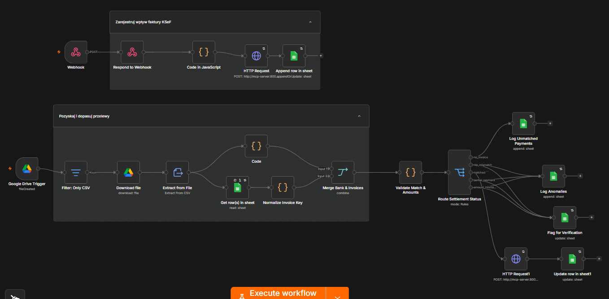
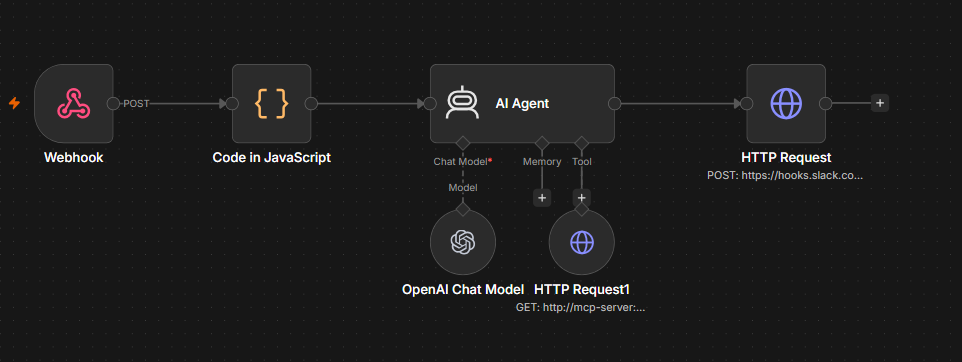
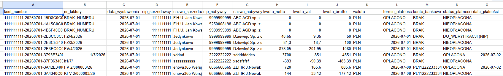
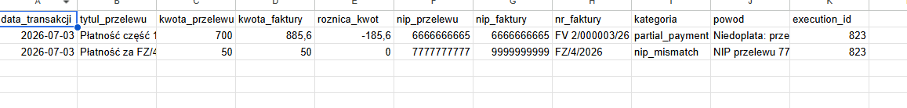

# 🏛️ Autonomous KSeF Invoice Reconciliation & Financial AI Agent

[](LICENSE)
[](https://www.python.org/)
[](https://n8n.io/)
[](https://www.postgresql.org/)
[](https://fastapi.tiangolo.com/)
[](https://www.docker.com/)

An end-to-end, production-grade financial automation architecture designed to ingest real-time fiscal B2B invoices from the Polish National e-Invoice System (**KSeF**), reconcile them deterministically against banking transaction records, detect financial anomalies, and serve an intelligent **Slack AI Assistant** via an internal **FastAPI / Model Context Protocol (MCP)** tool layer.

---

## ⚡ Key Highlights & Business Capabilities

* **KSeF Fiscal Sync & Ingestion:** Autonomous batch ingestion from the official KSeF API using a Python SDK, handling token session auth and direct streaming to n8n webhook nodes[cite: 13].
* **Deterministic Multi-Stage Reconciliation:** Cleans banking statement transfers, strips CSV UTF-8 BOM bytes, extracts NIP tax identifiers, and normalizes amounts using robust JavaScript regex logic[cite: 15]. Matches records against ledger entries using a rule engine (`matched`, `partial_payment`, `nip_mismatch`, `no_invoice`)[cite: 16].
* **Audit Trail & Anomaly Detection:** Segregates underpayments and mismatched counterparties into real-time verification ledgers with execution trace tracking (`execution_id`)[cite: 16].
* **Autonomous AI Data Layer:** A FastAPI application secured via Bearer Token (`MCP_SECRET`) provides structured endpoints (`/add-invoice`, `/update-status`, `/invoices`) that allow AI agents to safely read and update ledger data[cite: 11].

---

## 🏗️ System Architecture

* **Orchestration:** n8n configured with external node functions (`ksef-client`) and persistent volumes[cite: 9].
* **State Management:** PostgreSQL 17 backend[cite: 9]. The database is initialized with strict typings, default statuses (`UNPAID`), and performance indexes on `invoice_number`, `buyer_nip`, and `payment_status`[cite: 14].
* **Microservices:** Containerized Python 3.11 MCP server[cite: 10] utilizing Uvicorn and Pydantic for strict schema validation[cite: 11, 12].

---

## 📸 Production Run Previews

### 1. Invoice Ingestion & Bank Statement Reconciliation Pipeline
Autonomous orchestration in **n8n** showing KSeF ingestion, Google Drive CSV triggers, data normalization, and status-based rule splitting:



### 2. Conversational Financial AI Agent (Slack Integration)
LangChain-powered n8n AI Agent integrated with OpenAI and private MCP endpoints to deliver dynamic financial querying:



### 3. Reconciled Financial Ledger
Final database view containing settled invoices, KSeF identification numbers, computed VAT amounts, and payment statuses:



### 4. Anomaly Detection & Underpayment Segregation
Automated ledger auditing capturing edge cases alongside discrepancy logs:



---

## 📂 Repository Structure

```text
├── .env.example                     # Environment template for infrastructure & API keys
├── .gitignore                       # Production safety rules (secrets & data isolation)
├── docker-compose.yml               # Container specs (n8n, PostgreSQL 17, Caddy, MCP Server)
│
├── docs/
│   └── assets/                      # Production screenshots and system flow diagrams
│
├── mcp_server/
│   ├── Dockerfile                   # Container build spec for Python FastAPI service
│   ├── main.py                      # FastAPI / MCP tool server for AI Agent queries
│   └── requirements.txt             # Service dependencies (FastAPI, psycopg2, python-dotenv)
│
├── sample_data/
│   └── bank_statement_sample.csv    # Anonymized edge-case financial transaction test data
│
├── scripts/
│   ├── fetch_ksef_invoices.py       # Production KSeF API client & XML stream ingestion
│   ├── init_db.sql                  # PostgreSQL schema, payment status indexes & types
│   └── normalize_transfer.js        # Deterministic JS normalizer (BOM, NIP, currency sanitation)
│
└── workflows/
    ├── reconciliation-pipeline.json # n8n pipeline: Bank statement to KSeF matching
    └── slack-invoice-assistant.json # n8n pipeline: Slack AI conversational assistant

```

---

## 🚀 Quickstart & Deployment

### 1. Environment Setup

Clone the repository and configure your environment variables. A template is provided that strictly separates core n8n settings, PostgreSQL credentials, and external API keys.

```bash
git clone https://github.com/JohnStononloan/ksef-reconciliation-ai.git
cd ksef-reconciliation-ai
cp .env.example .env

```

### 2. Launch Infrastructure

Start PostgreSQL, n8n, Caddy (reverse proxy), and the internal FastAPI server using the provided bridge network (`n8n_network`):

```bash
docker compose up -d --build

```

### 3. Trigger KSeF Fiscal Sync

Run the batch ingestion script to pull invoices from the Ministry of Finance API and stream them into the processing queue:

```bash
python scripts/fetch_ksef_invoices.py

```

---

## 🔒 Security & Data Hygiene

* **Zero Hardcoded Secrets:** All credentials, keys, and tokens are isolated. The Python MCP server actively enforces the presence of `MCP_SECRET` at runtime.


* **Network Isolation:** Database and MCP microservices communicate over an internal Docker bridge network without exposing database ports to the public host.


